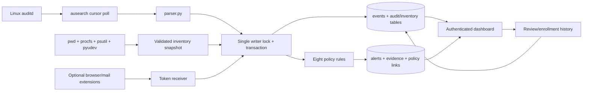
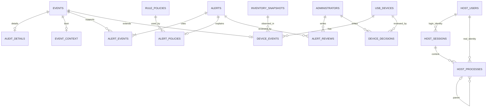

# KernelGuard: complete PBL viva guide

**Project explained:** the completed KernelGuard project in this directory.
**Last checked:** 14 October 2026 (UTC).
**How to use this guide:** read Sections 1–5 for the story, Sections 6–18 for the implementation, and Sections 19–25 for your demonstration and viva answers. Follow the source-file links when an examiner asks where a feature is implemented. Explain the parts you personally worked on in your own words.

> **One-sentence answer:** KernelGuard is a Linux host activity monitor that collects selected operating-system and optional application metadata, stores it in a relational database, raises explainable policy alerts, and lets an administrator investigate and record decisions.

## Contents

1. [The project in plain language](#1-the-project-in-plain-language)
2. [Phase 2 versus the completed project](#2-phase-2-versus-the-completed-project)
3. [Problem, objectives, scope, and honest claims](#3-problem-objectives-scope-and-honest-claims)
4. [Architecture and complete data flow](#4-architecture-and-complete-data-flow)
5. [Technologies and why they are used](#5-technologies-and-why-they-are-used)
6. [Project file map](#6-project-file-map)
7. [Configuration and startup](#7-configuration-and-startup)
8. [Linux Audit collection and parsing](#8-linux-audit-collection-and-parsing)
9. [Host inventory and USB observation](#9-host-inventory-and-usb-observation)
10. [Optional browser and mail reports](#10-optional-browser-and-mail-reports)
11. [The eight alert rules](#11-the-eight-alert-rules)
12. [Database design: all 17 tables](#12-database-design-all-17-tables)
13. [Transactions, replay, and concurrency](#13-transactions-replay-and-concurrency)
14. [Web dashboard, alert evidence, and investigation](#14-web-dashboard-alert-evidence-and-investigation)
15. [Administrator security and decisions](#15-administrator-security-and-decisions)
16. [Privacy and evidence limitations](#16-privacy-and-evidence-limitations)
17. [Deployment on this Kali host](#17-deployment-on-this-kali-host)
18. [Testing and evaluation](#18-testing-and-evaluation)
19. [What is verified and what remains](#19-what-is-verified-and-what-remains)
20. [Ten-minute viva demonstration](#20-ten-minute-viva-demonstration)
21. [Manual commands and SQL](#21-manual-commands-and-sql)
22. [Common problems and how to explain them](#22-common-problems-and-how-to-explain-them)
23. [Likely viva questions with model answers](#23-likely-viva-questions-with-model-answers)
24. [Short presentation script](#24-short-presentation-script)
25. [Study checklist and source references](#25-study-checklist-and-source-references)

## 1. The project in plain language

A computer creates many observations: a login attempt fails, a program runs, a watched file is opened, or a USB device appears. KernelGuard takes **selected metadata** from those observations and gives it structure. It does not read the contents of a file or a message. Each stored event has a kind, time, host, source, account label where known, resource, outcome, and a unique source identifier. Some operating-system events also have audit serial, syscall, login UID, real UID, effective UID, inode, and device information.

Rules examine the stored events. A rule match creates an **alert** with a severity score, a human-readable reason, links to the exact events that supported it, and a saved copy of the policy settings used at creation time. The dashboard lets a person inspect that evidence. An administrator may acknowledge or reopen an alert with a note. A USB device can be approved or revoked for future observations. These decisions are retained as history.

The project has three main collection paths:

| Path | What it observes | How it reaches the database |
| --- | --- | --- |
| Linux Audit | Selected failed authentication, watched file access, privileged commands, and optional broader file/process events | `auditd` records → `ausearch` → parser → normalized events |
| Linux inventory | Users, process snapshots, audit sessions, and currently enumerated USB devices | `pwd`, `/proc`, `psutil`, `pyudev` → validated snapshot → relational tables and USB events |
| Optional applications | Firefox/Chromium web URLs and Thunderbird recipient domains | Local extensions → token-protected receiver → normalized events |

The browser/mail path is **opt in**. The dashboard's Linux Audit health indicator measures the Audit poll only; it does not prove that inventory or application reporting is active.

### Essential terms

- **Event:** one normalized observation, such as `file_access` or `usb_seen`.
- **Alert:** a rule result based on one or more stored events.
- **Evidence link:** a row connecting an alert to the event that supports it.
- **Policy snapshot:** the rule parameters saved when an alert was created; later config changes do not rewrite history.
- **Collector:** a process that reads a source periodically and stores its observations.
- **Origin:** `demo` or `live`, recorded with the event. `live` identifies the ingestion source label, not cryptographic proof that the original source was truthful.
- **Checkpoint:** the stored Linux Audit cursor used to resume polling after a restart.
- **Inventory snapshot:** a sampled view of users, processes, and USB devices at one observation time.

## 2. Phase 2 versus the completed project

There are **two separate projects** in sibling folders. They must not be described as one database or one runtime:

| Topic | Separate Phase 2 project | Completed project explained here |
| --- | --- | --- |
| Folder | `KernalGuard-Phase2-PBL` in the local demo setup; original Phase II files at the repository root | `phase3/` in this repository |
| Usual local dashboard | `http://127.0.0.1:5002/` | MariaDB on `:5000`; Oracle MySQL 8.4 on `:5001` |
| Database | Dedicated `kernelguard_phase2` MySQL database | Separate MariaDB `kernelguard_live` and Docker MySQL 8.4 `kernelguard84`; SQLite is a standalone demo option |
| Alert rules | Repeated failed login and after-hours protected access | Those two, bulk files, privileged command, unapproved USB, risky web domain, HTTP visit, external-domain mail: eight total |
| Inventory | No USB inventory | Users, sessions, processes, USB, device enrollment |
| Review | Read-only Phase 2 dashboard | Administrator login, alert review, USB decisions |
| Synthetic fixture | 9 events, 2 alerts in a fresh Phase 2 demo | 21 events, 5 alerts in a fresh standard full-project demo; optional app examples add more |

Phase 2 can **observe** broader file opens and process launches without having extra alert policies. The separate local Phase 2 copy is a presentation reconstruction from the completed work; it is not proof of the exact historical source tree at the time of the original Phase 2 submission. The original Phase II files in this repository remain at its root. The complete project should be presented as the later, broader implementation. Do not say Phase 2 has USB inventory or that its dashboard uses the completed project's database.

## 3. Problem, objectives, scope, and honest claims

### Problem statement

Raw system logs contain useful security metadata but are difficult to read in isolation. They also do not by themselves provide a convenient relationship between a policy alert, the exact events supporting it, the rule settings at that time, and later human decisions. KernelGuard makes a small, explainable monitoring workflow for a **single Linux lab host**.

### Objectives

1. Collect selected operating-system and optional application activity.
2. Normalize dissimilar inputs into one event model without claiming identity when it is unknown.
3. Store events, inventory, alert evidence, saved policies, and review history in a relational database.
4. Detect clear, configurable policy matches.
5. Show the reason and linked evidence behind each alert.
6. Permit authenticated human review and USB enrollment decisions.
7. Support repeatable demos, tests, and a documented live lab check.

### What KernelGuard does **not** establish

- An alert means **a rule matched**, not that a crime, compromise, exfiltration, or malicious intent was proved.
- It does not block a file open, command, USB connection, website, or email.
- It is not a kernel module, antivirus engine, endpoint protection suite, packet sniffer, or machine-learning classifier.
- It does not prove that a file was copied; a watched file access is metadata about an audited open/access.
- It does not prove that a browser page finished loading or that an email was delivered by a mail server.
- It does not know who physically inserted a USB device.
- A nearby event on the same host is not necessarily caused by the same person.

These limits are strengths in a viva answer: they show the distinction between observed data and an inference.

## 4. Architecture and complete data flow



### Example: a watched file read

1. The Linux Audit rule for `/srv/kernelguard/protected` records syscall metadata when the watched directory is accessed. The directory must exist before the audit rule is loaded.
2. `kernelguard collect` calls `ausearch --input-logs --checkpoint ... --raw`. On a first poll for a boot it starts at `boot`; later polls resume from the saved cursor.
3. The parser groups raw `SYSCALL`, `PATH`, and related lines by audit timestamp and serial. It extracts metadata and emits one or more `file_access` events.
4. The collector obtains the writer lock and opens a database transaction. `ingest` checks the event's unique `source_id`, stores a new event and optional `audit_details`/`event_context`, then evaluates policy rules.
5. If the successful path is under the configured protected root and the local hour is outside the allowed interval, an after-hours alert is inserted. `alert_events` points to the exact event and `alert_policies` points to the policy settings saved for that alert.
6. The database transaction commits the event, alert, links, and updated Audit checkpoint together. If anything fails, they roll back together; the cursor does not advance past data that was not stored.
7. The dashboard reads the database. The alert detail page shows the reason, supporting activity, audit metadata, original policy, and review history.

### Example: a newly observed USB device

The inventory collector periodically enumerates USB devices through `pyudev`. The storage service compares the new complete snapshot with earlier presence state. A new or reappearing identity produces `usb_seen`; a previously present identity absent from a complete enumeration produces `usb_absent`. A new/reappearing device without a current approval creates an `Unapproved USB device` alert. The **connection observed** time is when KernelGuard saw it in a poll. It may be later than the physical plug-in time. A 10-second polling interval can miss quick attach/remove cycles.

### Example: a reported web visit

An installed extension reports a URL to a separate local receiver using a bearer token. The receiver validates the JSON and stores only the scheme, host, and path; query strings and fragments are removed. A configured risky-domain match or an unencrypted HTTP visit can produce an alert. The operating system does not independently confirm that the user viewed the page.

## 5. Technologies and why they are used

| Technology | Role in KernelGuard | Viva explanation |
| --- | --- | --- |
| Python 3 | Implementation language and CLI | A single language connects parsing, policy logic, database access, and UI. |
| Linux Audit (`auditd`, `ausearch`) | OS event source | The kernel audit subsystem records selected syscall metadata; KernelGuard consumes it in user space. |
| `pwd`, `/proc`, `psutil`, `pyudev` | Host inventory | They provide account, boot/session, process, and USB metadata. |
| Pydantic | Strict config and snapshot validation | Invalid fields, types, and duplicate identities are rejected before storage. |
| SQLAlchemy | Table definitions, parameterized SQL, transactions | It supports SQLite demos and MySQL/MariaDB without rewriting policy logic. |
| PyMySQL | Python MySQL protocol driver | It connects SQLAlchemy to MySQL 8.4 or MariaDB. |
| Oracle MySQL 8.4 / InnoDB | Live relational DBMS on this host | Primary/foreign keys, indexes, transactions, rollback, and separate database accounts. |
| SQLite | Local/demo and fast isolated tests | A file-based DB that needs no server; it is not the running MySQL 8.4 deployment. |
| Flask + Jinja | Dashboard routes/templates | Server renders evidence pages and handles administrator forms. |
| Waitress | Local HTTP server | Serves Flask on `127.0.0.1`, not a public network interface. |
| Werkzeug | Password hashing | Passwords are stored as hashes, not plaintext. |
| Portalocker / MySQL advisory lock | Cooperating writer coordination | Prevents the project's collectors from writing concurrently without coordination. |
| pytest | Regression tests | Checks rule boundaries, rollback, replay, web behavior, and relationships. |
| Docker | MySQL 8.4 container on this Kali host | Runs the Oracle MySQL server separately from host MariaDB. |
| systemd | Persistent local services | Starts and restarts the dashboard and collectors on Linux. |

[requirements.txt](../requirements.txt) declares Python package ranges. [config.example.json](../config.example.json) is the current example policy file. SQLAlchemy is a library used by the project; KernelGuard did not implement a DBMS from scratch.

## 6. Project file map

The outer `KernalGuard/` folder is the repository. The inner `kernelguard/` folder is its Python import package. It is **not** a duplicate project.

| Location | Responsibility |
| --- | --- |
| [`kernelguard/__main__.py`](../kernelguard/__main__.py) | CLI commands, database selection, Audit polling and checkpoints, demo import, inventory loop, dashboard/receiver serving. |
| [`kernelguard/config.py`](../kernelguard/config.py) | Strict configuration validation and defaults. |
| [`kernelguard/parser.py`](../kernelguard/parser.py) | Linux Audit grouping and normalization. |
| [`kernelguard/core.py`](../kernelguard/core.py) | Core tables, event insertion, deduplication, login and after-hours policies, alert/policy links. |
| [`kernelguard/activity_rules.py`](../kernelguard/activity_rules.py) | Privileged-command and bulk-file policies. |
| [`kernelguard/app_activity.py`](../kernelguard/app_activity.py) | Optional local receiver, privacy normalization, website/mail policies. |
| [`kernelguard/locking.py`](../kernelguard/locking.py) | SQLite file lock or MySQL advisory writer lock. |
| [`kernelguard/inventory/models.py`](../kernelguard/inventory/models.py) | Validated user/process/USB snapshot contract. |
| [`kernelguard/inventory/collector.py`](../kernelguard/inventory/collector.py) | Linux inventory adapter. |
| [`kernelguard/inventory/schema.py`](../kernelguard/inventory/schema.py) | Inventory and device-decision tables. |
| [`kernelguard/inventory/service.py`](../kernelguard/inventory/service.py) | Atomic snapshot persistence, identities, USB presence changes and alerts. |
| [`kernelguard/inventory/routes.py`](../kernelguard/inventory/routes.py) | Inventory/device pages and enrollment form. |
| [`kernelguard/auth.py`](../kernelguard/auth.py) | Administrators, password hashes, sessions, login, CSRF protection. |
| [`kernelguard/reviews.py`](../kernelguard/reviews.py) | Append-only alert review changes. |
| [`kernelguard/web.py`](../kernelguard/web.py) | Dashboard, alert details, event investigation, review routes. |
| [`kernelguard/investigation.py`](../kernelguard/investigation.py) | Labels relationships in an event-centered timeline. |
| `kernelguard/templates/`, `kernelguard/static/`, `kernelguard/refresh.js` | HTML, CSS, and 15-second dashboard refresh. |
| `fixtures/` and [`kernelguard/demo.py`](../kernelguard/demo.py) | Deterministic synthetic audit and inventory examples. |
| `tests/` | SQLite and opt-in MySQL integration tests. |
| `scripts/evaluate.py` | Policy cases and bounded synthetic ingestion benchmark. |
| `sql/schema.mysql.sql`, `sql/analysis.sql` | Reviewable DDL export and read-only analysis queries. The Python metadata creates runtime tables. |
| `linux/` | Audit rules and example systemd units. |
| `docs/` | Setup, architecture, operations, acceptance, evaluation, contribution records. |

## 7. Configuration and startup

### Configuration values

The CLI loads [config.example.json](../config.example.json) if supplied with `--config`. Missing optional fields use defaults from `ProjectSettings`. The current example specifies the default protected path and time policy. Key values are:

| Setting | Current default/example | Meaning |
| --- | --- | --- |
| `host_id` | `kernelguard-lab` | Scope label for observations. |
| `protected_path` | `/srv/kernelguard/protected` | Tree checked by after-hours and bulk rules. |
| `timezone` | `Asia/Kolkata` | Local clock used only for the after-hours rule. UI timestamps are UTC. |
| `allowed_start_hour`, `allowed_end_hour` | `9`, `18` | Allowed interval is 09:00 inclusive to 18:00 exclusive in the configured timezone. |
| `login_threshold`, `login_window_seconds` | `5`, `300` | Five failures in five minutes. |
| `bulk_file_threshold`, `bulk_window_seconds` | `10`, `60` | Ten distinct protected paths in one minute, with same host/source/account/session/boot. |
| `privileged_executables` | `passwd`, `useradd`, `usermod` full paths | Selected programs for root-effective execution alerts. |
| `risky_web_domains` | empty | No risky-site alerts until domains are configured. |
| `trusted_email_domains` | empty | No external-mail alerts until a trusted set is configured. |
| `alert_insecure_http` | `true` | Plain HTTP visits alert if app reports are enabled. |

Pydantic rejects unexpected fields, wrong types, invalid domain names, impossible hour ranges, and invalid paths. The protected path and executable paths are normalized. A real config change must be supplied consistently to the relevant collectors/receiver/dashboard; the dashboard displays the active settings passed to its process. **Old alerts keep their saved policy snapshots.**

### Database selection

`KERNELGUARD_DB_URL` selects the completed project's database. Without it, the CLI defaults to `sqlite:///data/kernelguard.db`. A MySQL URL uses the SQLAlchemy `mysql+pymysql://...` dialect. Do not copy credentials into a report, repository, screenshot, or command history. On this host, systemd reads protected environment files for the MySQL 8.4 services.

### Main commands

Run from the project root with the virtual environment active. `--config` comes **before** the command:

```bash
python -m kernelguard --config config.example.json init-db
python -m kernelguard --config config.example.json demo
python -m kernelguard --config config.example.json demo --baseline
python -m kernelguard --config config.example.json collect --once
python -m kernelguard --config config.example.json inventory --once
python -m kernelguard --config config.example.json serve --port 5000
python -m kernelguard --config config.example.json activity-serve --port 5003
```

Other commands: `import-audit PATH [--origin demo|live]`, `import-inventory PATH`, and `create-admin USERNAME` (password prompted privately). `collect` defaults to five-second polling and `inventory` to ten seconds. Linux Audit collection and live inventory need Linux and appropriate permissions. `serve` uses Waitress on loopback. Do not run `demo` against a live presentation DB without intending to add synthetic records.

A fresh standalone full demo imports 21 events and produces five alerts, plus two users, one audit session, three processes, and one USB identity. Re-running it adds no duplicate fixture observations. Demo counts in a long-running database will differ.

On Windows, the Python demo and dashboard can run using the PowerShell launcher in `scripts/start.ps1` and a local virtual environment. Live Linux Audit and live Linux inventory require Linux; a Windows demo must be described as synthetic. The separate Phase 2 project can also run its MySQL-backed fixture on Windows, but it does not become the completed project's database or feature set.

## 8. Linux Audit collection and parsing

### What Linux Audit contributes

The [protected-directory rule](../linux/kernelguard.rules) watches `/srv/kernelguard/protected` on x86_64 Linux. The [privileged-execution rule](../linux/privileged-execution.rules) records selected root-effective execution metadata from regular login identities. [Optional broader rules](../linux/activity-observation-kali.rules) can observe file opens in home/mounted paths and process launches; they can generate many rows. A watched file must be covered by an installed and loaded audit rule; merely listing a path in the JSON config does not cause the kernel to log it.

`auditd` records raw lines. Several lines can describe **one audit event**, linked by `msg=audit(timestamp:serial)`. For example, `SYSCALL` describes the syscall and actor, while `PATH` describes a related pathname. Treating each line as an independent action would miscount activity.

### Parser behavior

[`parser.py`](../kernelguard/parser.py) groups by audit timestamp and serial, sorts groups, and extracts supported event kinds:

- Failed `USER_AUTH` from `sshd`, `sshd-session`, `sshd-auth`, or `login` → `login_failure`. It does not also count `USER_LOGIN`, because that could double-count a PAM attempt.
- `SYSCALL` with `kernelguard_privileged`, supported x86_64 execute syscall, and identity metadata → `privileged_exec`.
- `SYSCALL` with `kernelguard_process_exec` → `process_exec`.
- `SYSCALL` plus `PATH` with `kernelguard_protected` or `kernelguard_file_access` → `file_access`. Parent PATH entries are ignored; repeated paths within one audit group are deduplicated.

The parser resolves relative paths using `CWD`, normalizes paths, decodes applicable audit hex-encoded fields, and retains the audit serial and selected syscall/inode/device information in `audit_details`. It ignores command arguments, `PROCTITLE`, and file contents.

### AUID, UID, EUID: an examiner favorite

- **AUID (audit/login UID):** identity associated with the login session. It can remain the original user after `sudo`.
- **UID (real UID):** current process real user identity.
- **EUID (effective UID):** privilege identity used for access checks; `0` is root.

A command may have login AUID 1000 and effective UID 0. KernelGuard keeps these fields separate. For a failed login, the account name is an **attempted** identity; nobody has necessarily authenticated. Unknown audit values such as `4294967295` and `-1` are treated as unknown, not as valid users.

### Checkpoints, boot identity, and errors

`collect_once` uses a checkpoint scoped to host and boot ID. The event source hash includes boot context for live collection so an audit serial reused after reboot does not collide with the previous boot. New events and the new cursor are committed in the same transaction. An empty successful poll updates collector health. On this host, `ausearch` sometimes returns status 1 with empty output for no new records; the collector accepts only that specific idle form and raises on other failures. A failed source query does not advance the cursor or claim a healthy poll.

The dashboard says `Active` when the stored Audit `last_poll` is less than 30 seconds old. This is **poll freshness**; inspect stored event time and audit rules separately to establish whether the source produced events.

## 9. Host inventory and USB observation

### How a snapshot is made

[`inventory/collector.py`](../kernelguard/inventory/collector.py) reads Linux boot ID from `/proc`, users from `pwd`, processes and start times through `psutil` and `/proc`, and USB devices through `pyudev`. Root USB hubs are skipped because they are controllers, not enrollment candidates. The snapshot has `host`, `origin`, `boot_id`, observation `timestamp`, lists of users/processes/devices, `processes_complete`, and warnings.

[`inventory/models.py`](../kernelguard/inventory/models.py) uses strict Pydantic models. It rejects duplicate UIDs, duplicate PIDs, ambiguous duplicate USB fingerprints, invalid IDs, or extra unexpected data. If some processes cannot be read because they exit or permissions deny access, the snapshot is marked incomplete and a warning is kept. The storage code does **not** mark unseen processes/sessions as exited from an incomplete process scan. A failed USB enumeration stops that poll rather than treating all devices as unplugged.

### Why identities need scope

A PID can be reused, so a process identity includes host, origin, boot ID, PID, and process start time. An audit session number can be reused after reboot, so a session identity includes the boot ID. A user identity is scoped by host, origin, and UID. A USB identity uses host, origin, vendor, product, and serial when available; without a serial it uses the physical port. A port-based identity can change when a device moves. Even a serial can be spoofed, so approval is an administrator decision about an observed identifier, not hardware authentication.

### Persistence and device transitions

[`inventory/service.py`](../kernelguard/inventory/service.py) rejects exact duplicate snapshots and a different snapshot older than the last accepted observation for that host/source. It saves users, sessions, processes, devices, and presence transitions in one transaction. Parent-process links are added only when the parent is in the same snapshot and started earlier; otherwise the relationship remains unknown.

A device's `first_seen` is its earliest stored observation; `last_seen` is the most recent poll that saw it. `connected_at` on the UI is computed from the latest `usb_seen` event. A continuously present USB device keeps the earlier connection-observed time while its `last_seen` advances. A new or reappearing unapproved identity creates an alert. A complete poll that no longer sees a previously present device stores `usb_absent`. Approval affects **future** `usb_seen` decisions; it does not erase old alerts. The baseline Kali boot USB drive must remain connected; no spare device was available for a physical detach/reconnect test.

## 10. Optional browser and mail reports

Linux Audit cannot tell which page a browser displayed or whether Thunderbird sent a message. KernelGuard therefore has optional local browser and Thunderbird extensions. They send JSON to the receiver at `127.0.0.1:5003/v1/activity` with a bearer token of at least 32 characters. Only supported `type`/`application` combinations are accepted: `web_visit` from Firefox or Chromium, `email_sent` from Thunderbird. Unrecognized fields and bad values are rejected.

For a web URL, the receiver stores only scheme, normalized host/port, and path; it drops query parameters, fragments, and URL credentials. It does **not** save page text. For mail, it stores lowercased, deduplicated recipient **domains**, not addresses, subject, body, or attachments. `app:firefox`, `app:chromium`, and `app:thunderbird` are application labels, **not** verified Linux user accounts. The receipt time is used as the event timestamp. Reused extension event IDs are deduplicated.

The receiver returns 201 for a new event and 200 for replay. It rejects an absent/wrong token (401), unsupported content type (415), invalid payload (400), and a busy writer (503). It binds to loopback, but a valid token holder can submit a report; the token and browser profile need protection. Extension delivery is best effort, with no offline queue guaranteed by this project. See [APP_ACTIVITY.md](APP_ACTIVITY.md).

**Current Kali status:** five synthetic app records were inserted in the MySQL 8.4 database on 14 October 2026: three web visits and two mail reports, with three expected alerts. They are marked `demo`. The optional receiver is installed and running as `kernelguard-mysql84-activity.service` on loopback port 5003. The deployed config trusts `gmail.com` for mail. Thunderbird 158.0 has the Gmail account connected, and its KernelGuard Sent Mail Activity add-on is enabled and configured with the local receiver token. A real Thunderbird send to `geu.ac.in` was verified as live MySQL event `239365`, received on 15 October 2026 at 19:40:18 UTC (16 October at 01:10:18 IST), linked to alert `31`, **Email to external domain**, score 65. This verifies extension reporting and storage, not delivery to the recipient inbox. `risky_web_domains` remains empty, while HTTP alerts are enabled by default. The demo records used temporary policy settings to test the risky and external-mail rules; they did not alter the then-live config.

## 11. The eight alert rules

**Every rule produces a policy signal, not a verdict.** Severity scores rank attention. The dashboard labels score 70 or more as High and the other current scores as Medium. These numbers are configured project scores, not probabilities.

| # | Alert rule | Exact trigger in the code | Score | Evidence / important limit |
| --- | --- | --- | --- | --- |
| 1 | Repeated login failures | At least 5 `login_failure` events within 300 seconds for the same host, origin, account, and boot context | 60 | Links the failure episode. Attempted account does not prove a successful login. |
| 2 | After-hours protected access | Successful `file_access` under protected path outside 09:00–18:00 in `Asia/Kolkata` (current example) | 70 | Links the access. A legitimate late backup can match. |
| 3 | Bulk protected-file activity | At least 10 **distinct** successful protected paths within 60 seconds, same host, origin, account, audit session, and boot context | 70 | Links the fresh paths. Repeating one path does not meet threshold; a backup may match; copying is not proved. |
| 4 | Sensitive privileged command | Successful `privileged_exec`, effective UID 0, known non-root login UID, executable in configured list | 75 | Links one command execution. Root-effective legitimate administration may match. Arguments are not retained. |
| 5 | Unapproved USB device | New/reappearing USB identity without a current approval | 65 | Links `usb_seen` and device record. Identity is not a verified person or authentic device. |
| 6 | Configured risky website | Reported browser visit hostname equals or is a subdomain of a configured risky domain | 70 | Links the web report. List is empty by default; a report is not independent page-load proof. |
| 7 | Unencrypted web visit | Reported HTTP visit if `alert_insecure_http` is true and risky-domain rule did not already match | 45 | Links the web report. This detects scheme, not all possible transport risks. |
| 8 | Email to external domain | Reported sent-mail recipient domain outside a **nonempty** trusted-domain list | 65 | Links the mail report. It does not prove delivery or that the message was harmful. |

### Two worked calculations

- Failed login: five failed `USER_AUTH` observations at 10:00, 10:01, 10:02, 10:03, and 10:04 for the same account can make one 5-minute episode alert. Four fail the threshold. A different host/account, source, or boot does not join that group. Used evidence events are excluded from later disjoint episodes.
- Bulk files: ten reads of ten different protected paths within 60 seconds, same host/source/account/session/boot, can alert. Ten reads of one path do not. The code does not assert that files were copied; the metadata only shows successful observed accesses.

After-hours uses the configured local timezone; database and dashboard timestamps are shown in UTC. For the default interval, exactly 09:00 local is allowed and exactly 18:00 is outside it. The code also handles an allowed interval that crosses midnight. Risky-domain matching takes precedence over the plain-HTTP rule on one web event, so one risky HTTP report receives the risky alert rather than two web alerts from those two branches.

## 12. Database design: all 17 tables

SQLAlchemy defines the schema in [`core.py`](../kernelguard/core.py) and [`inventory/schema.py`](../kernelguard/inventory/schema.py). MySQL creates 17 InnoDB tables with `utf8mb4_bin` table collation, even though the server's database-level default collation may differ. SQLite tests explicitly enable foreign keys. Keys and relationships are enforced by the DBMS.

| Table | Important fields | Why it exists |
| --- | --- | --- |
| `events` | `id` PK, unique `source_id`, host, Unix timestamp, kind, account, resource, outcome, origin | One normalized observation per row. |
| `audit_details` | `event_id` PK/FK, audit timestamp/serial, login/real/effective UID, syscall, inode/device | Extra OS-specific facts without adding many Audit-only columns to every event. |
| `event_context` | `event_id` PK/FK, boot ID | Keeps boot context for live Audit evidence. |
| `alerts` | `id` PK, unique `dedup_key`, rule, timestamp, account, score, reason | One rule result per row. |
| `alert_events` | composite PK `alert_id` + `event_id`, both FKs | Many-to-many evidence links; one alert may have several events, one event can support multiple alerts. |
| `rule_policies` | policy ID PK, rule code, version, JSON parameters | Reusable, immutable policy setting snapshots. |
| `alert_policies` | `alert_id` PK/FK, policy ID FK | Tells which settings produced an alert. |
| `checkpoints` | name PK, value | Audit cursor and collector health information. |
| `administrators` | ID PK, unique username, password hash | Local administrator identity. |
| `alert_reviews` | ID PK, alert FK, administrator FK, action, note, timestamp | Append-only acknowledge/reopen history. |
| `inventory_snapshots` | ID PK, host, origin, boot ID, time, completeness and warnings | One accepted inventory poll. |
| `host_users` | stable ID PK, host/source, UID, username, last seen/present | Current and historical observed user identities. |
| `host_sessions` | stable ID PK, boot/session, optional user FK, first/last seen/present | Boot-scoped audit-session observations. |
| `host_processes` | stable ID PK, boot/PID/start, parent/session/user FKs, last seen/present | Process snapshots and supported relationships. |
| `usb_devices` | stable ID PK, vendor/product/serial or port, first/last seen/present | Device identity and sampled presence. |
| `device_events` | event ID PK/FK, device FK, snapshot FK | Relates a `usb_seen`/`usb_absent` event to a device and snapshot. |
| `device_decisions` | ID PK, device FK, administrator FK, approved flag, note, time | Append-only approval/revocation history. |

### Relationship diagram



**Why separate tables?** Audit-only metadata, mutable inventory state, immutable event history, alert evidence, and human decisions have different meanings and lifecycles. Foreign keys avoid storing ambiguous comma-separated evidence IDs. Join tables represent many-to-many relationships. Separate policy snapshots let old alerts remain explainable after a configuration change. The schema includes indexes for event account/kind/time, snapshot scope/time, process context, and review/decision history. To discuss a query plan, use `EXPLAIN` on actual lab data rather than assuming an index was selected.

### Example SQL worth understanding

```sql
SELECT a.id, a.rule, a.reason, e.kind, e.origin, e.resource
FROM alerts AS a
JOIN alert_events AS ae ON ae.alert_id = a.id
JOIN events AS e ON e.id = ae.event_id
ORDER BY a.id DESC, e.timestamp DESC
LIMIT 20;
```

This does **not** infer evidence by time proximity. It follows explicit foreign-key links. [sql/analysis.sql](../sql/analysis.sql) contains additional read-only examples.

## 13. Transactions, replay, and concurrency

### Atomicity

A SQLAlchemy `with engine.begin() as conn` block commits at successful exit and rolls back on an exception. Audit ingestion puts new events, alert rows, evidence/policy links, and checkpoint advancement in the same transaction. Inventory persistence puts the accepted snapshot, user/process/device state, USB events, and any USB alerts in one transaction. This avoids a saved cursor with missing events or a device alert with no committed supporting event.

### Replay and uniqueness

Raw Audit identity, host/source information, and boot context produce SHA-256-based `source_id` values. The database has a unique constraint on `events.source_id`. `ingest` checks it before insertion; replay returns `False`. Alerts have their own unique `dedup_key`. Snapshot identity is a digest of the serialized snapshot. Re-running a deterministic demo therefore does not multiply records. The hash is **for identity/deduplication, not cryptographic proof of log authenticity**. A replay may enrich a legacy event with actual audit details, but it does not invent a historical policy snapshot.

### Coordinated writes

[`locking.py`](../kernelguard/locking.py) uses a MySQL named advisory lock scoped to the database name, or a Portalocker file lock for file-backed SQLite. The Audit collector, inventory collector, application receiver, and review/enrollment operations cooperate with the lock. It prevents those participating writers from stepping on one another. It cannot stop an unrelated program that ignores the lock, so SQL transactions and constraints still matter. A busy periodic collector retries later; a submitted UI decision reports a conflict rather than silently overwriting a newer decision.

### Current database verification

On 14 October 2026, the Oracle MySQL 8.4.11 container was running with 17 application tables. All 17 tables were InnoDB with `utf8mb4_bin` table collation and 17 foreign-key relationships. Read-only relationship checks found zero orphaned alert/event links, zero alerts without evidence, zero alerts without a saved policy, and zero checked orphaned audit/device links. A separate temporary-schema MySQL integration test passed transaction rollback, foreign-key, alert, inventory, and decision checks; that schema was removed afterward. At 21:31 UTC the database held 10,931 events and 26 alerts, including the five demo app events. These counts change while live collectors run; do not recite them as permanent totals.

## 14. Web dashboard, alert evidence, and investigation

The dashboard is implemented in [`web.py`](../kernelguard/web.py), Jinja templates, and CSS. It reads the selected database; it is not a separate evidence store.

| Route / area | What to show in the viva |
| --- | --- |
| `/` | Overview cards, Audit poll health, recent file/process/app observations, latest 100 matching events, active policy summary. |
| `/#alerts` | Latest 30 alert rows; source tabs All / Recorded live / Demo. Each row shows severity, rule, reason, review state, timestamp, source badge. |
| `/?kind=file_access#activity` | Filter event explorer by kind. It also supports exact account and resource substring. |
| `/alerts/<id>` | Reason, linked supporting events, saved policy settings, audit fields where available, device link, review history. |
| `/investigate/<event_id>` | Nearby event timeline with 15-, 60-, or 240-minute windows and explicit relationship labels. |
| `/inventory` | Paginated users/sessions/processes/devices; host and origin filters; recent snapshot warnings. |
| `/devices/<identity>` | Enrollment state, latest connection-observed time, last-seen poll, presence changes and decision history. |
| `/login` | Administrator sign-in when an account exists. |

The dashboard refreshes every 15 seconds while visible and while the user is not editing a filter. Displayed event times are formatted in **UTC** from stored Unix seconds. The after-hours policy converts event time to the configured timezone. A “Recorded live” alert means its linked events have origin `live`; a “Synthetic demo” alert means linked events have origin `demo`. It does not independently authenticate the source. The source tabs filter alerts; the activity form filters events. The open-alert card includes **all sources**, so demo alerts may be part of that number.

The event investigation route gathers nearby events from the same host and the same demo/live class. It limits candidates to 500 closest observations and labels a row as selected event, same user and session, same user, same attempted account with login unverified, or host context with user unverified. It excludes mismatched known boot IDs. Browser/mail/USB reports do not inherit a Linux user merely because another event is nearby. Time proximity is context, not proof of causation.

## 15. Administrator security and decisions

[`auth.py`](../kernelguard/auth.py) stores a salted Werkzeug password hash; the password is not stored in the repository or in plaintext in the database. New administrators are created through the CLI with a private password prompt (12–256 characters required for new accounts). Once at least one administrator exists, a session secret of at least 32 characters is required to start the dashboard. Without an administrator, the site is a read-only preview and write routes are denied.

Signed Flask sessions have a 30-minute lifetime. Cookies are HttpOnly and SameSite=Strict; Secure is enabled when `KERNELGUARD_HTTPS=1` for an HTTPS deployment. POST requests require a CSRF token. Login attempts are limited to five in five minutes per server process. Values are rendered through Jinja escaping; the tests include HTML escaping cases. Database queries use SQLAlchemy parameter binding rather than constructing SQL with user text.

An alert review is either `acknowledge` or `reopen`, always with a 1–1000 character note. The new decision inserts a row; it does not delete the old decision. The form carries the latest review ID. If another administrator changed the state first, the stale form returns HTTP 409 and asks for a reload. USB approval/revocation follows the same history and stale-form idea. Approval affects future observations only, and neither review nor enrollment blocks OS activity.

The running MySQL 8.4 deployment uses separate database roles: an elevated collector role writes observations; the web role reads evidence and has narrowly scoped insert permission for review and device-decision rows. The web server runs as an unprivileged Linux user on loopback. Credentials/session secrets are in root-owned environment files outside the repository. Do not disclose those files or any actual administrator password during a viva.

## 16. Privacy and evidence limitations

Explain these distinctions calmly if asked whether the project is “real time” or “forensic proof”:

1. **Polling delay:** Audit collection defaults to every five seconds and inventory to every ten. The dashboard refreshes every 15 seconds. These are different stages, so a screen can lag a physical action.
2. **USB timing:** connection-observed time is the inventory poll that saw `usb_seen`, not the exact electrical insertion time. Removal is absence from a complete poll, not the exact unplug time.
3. **Process snapshots:** short-lived processes can appear and disappear between polls; permission errors can make a scan incomplete.
4. **Application reports:** optional extensions report activity; the OS does not validate page load or mail delivery. The receiver is active on loopback port 5003.
5. **Identity:** AUID, UID, EUID, app labels, and attempted login names are different. Do not equate an `app:firefox` event to a verified person.
6. **Origin:** `demo` is synthetic; `live` is a source label assigned during collection/import, not a tamper-proof provenance certificate. An imported Audit file can also be labelled `live` by its operator.
7. **Scope:** only activity covered by installed rules or optional extensions can be observed. No packet capture, keylogging, content inspection, or automatic remediation exists.
8. **Security outcomes:** policy alerts can have false positives (authorized backup or administration). There is no measured production precision/recall.
9. **Retention/authenticity:** source hashes suppress duplicates but do not prove logs were untampered. A privileged database administrator can still modify stored rows; this is not an immutable forensic ledger.

The system intentionally stores URL paths and recipient domains only for app reports. URL paths can still contain sensitive information, so access to the dashboard/database should be limited.

## 17. Deployment on this Kali host

There are three active local dashboards, but the **completed-project MySQL 8.4 instance** is the clearest one for the viva:

| URL | Project/database | Meaning |
| --- | --- | --- |
| `http://127.0.0.1:5001/` | Completed project + Oracle MySQL 8.4, Docker DB `kernelguard84` | Preferred live full-project demo. |
| `http://127.0.0.1:5000/` | Completed project + host MariaDB `kernelguard_live` | Earlier parallel live deployment. |
| `http://127.0.0.1:5002/` | Separate Phase 2 project + its dedicated MySQL database | Show only when explaining Phase 2. |
| `http://127.0.0.1:5003/` | Optional application receiver endpoint | Not a dashboard; running as `kernelguard-mysql84-activity.service` on this Kali host. |

MySQL 8.4.11 runs in Docker container `kernelguard-mysql84` with a named persistent volume and a localhost-only database port 3307. The completed application source used by systemd is `/home/kali/Desktop/KernalGuard`; the editable project folder for this guide is the mounted Acer-volume checkout. Changes to this checkout are not automatically deployed unless copied to the runtime folder and the appropriate services are restarted. The MySQL-backed services are `kernelguard-mysql84-web.service`, `kernelguard-mysql84-audit.service`, `kernelguard-mysql84-inventory.service`, and `kernelguard-mysql84-activity.service`. On 14 October 2026 all four were active; Audit events and inventory snapshots were reaching MySQL. Live Thunderbird reporting was subsequently verified with event `239365` and alert `31`. See [MYSQL84_DOCKER.md](MYSQL84_DOCKER.md) for deployment commands.

Do not unplug the detected Cruzer Blade: it is the Kali boot drive. No separate expendable USB device was available to demonstrate physical removal/reconnection. Synthetic inventory tests cover the software transition logic, but they are not a physical-hardware observation.

## 18. Testing and evaluation

From this project root:

```bash
.venv-linux/bin/python -m pytest tests -q
.venv-linux/bin/python -m scripts.evaluate
.venv-linux/bin/python -m scripts.check_environment
```

The latest full default regression run produced **103 passed, 1 skipped**; the skipped case is an **opt-in MySQL integration test** unless a disposable `KERNELGUARD_TEST_MYSQL_URL` is supplied. On 14 October 2026, that same MySQL integration test passed separately against a temporary Oracle MySQL 8.4 schema; the temporary schema was removed. The evaluation script's saved report documents **11/11 expected synthetic policy outcomes**. Its benchmark is a bounded synthetic SQLite ingestion sample and must not be described as measured production throughput.

Test groups and what they establish:

- `test_pipeline.py`: parser, failed-login windows, after-hours boundaries, replay, dashboard escaping/filters, checkpoint behavior.
- `test_activity_reviews.py`: privilege/bulk rules, auth, CSRF, review transitions, upgrade preservation.
- `test_inventory.py`: snapshots, stable identities, partial scans, USB transitions, device UI and enrollment.
- `test_app_activity.py`: receiver authorization, privacy trimming, risky/HTTP/mail alerts and replay.
- `test_alert_sources.py`: all eight rules on synthetic evidence, live/demo badges and filters.
- `test_investigation.py`: timeline relationship labels and identity uncertainty.
- `test_concepts.py`: foreign keys, rollback, lock behavior, saved policy history, invalid configuration.
- `test_mysql.py`: real MySQL transactions, foreign keys, replay, reviews and device-decision workflow in a disposable DB.

**Positive and negative cases matter.** The app demo intentionally included risky HTTPS and ordinary HTTP (alerts), external-domain mail (alert), safe HTTPS (no alert), and trusted-domain mail (no alert). Five demo records and three demo app alerts were stored in the MySQL 8.4 database, then checked through SQL and authenticated dashboard pages. Replaying their IDs added nothing. These demo cases test the application logic and database display. Separately, real Thunderbird extension delivery was verified with live event `239365` and linked alert `31`.

## 19. What is verified and what remains

| Claim | Evidence/status as of 14 October 2026 |
| --- | --- |
| Standard full demo | Fresh fixture expectation is 21 events/5 alerts; replay tests pass. |
| Eight alert rules | Synthetic end-to-end test creates all eight and verifies linked evidence/source display. |
| Live protected-file/privileged/bulk/login | Earlier Kali lab checks documented in [LIVE_AUDIT_CHECK.md](LIVE_AUDIT_CHECK.md); live database continues receiving Audit data. |
| Live inventory and USB first observation | Services and stored snapshots/device events verified. |
| Oracle MySQL 8.4 | Running version 8.4.11; 17 InnoDB tables, 17 foreign-key references, relationship checks clean; temporary-schema integration test passed. |
| Dashboard and reviews | Authenticated live HTTP checks and regression tests pass. |
| Browser/mail policy logic | Five synthetic app examples, three expected alerts, two expected no-alerts verified in MySQL and dashboard. |
| Live mail extension flow | Real Thunderbird send recorded as live event `239365` (`geu.ac.in`), linked to external-domain alert `31`. Add-on enabled in the active Gmail profile; `gmail.com` is trusted. |
| Live browser extension flow | Not established by the Thunderbird verification; browser demo records alone do not prove live browser reporting. |
| Physical USB disconnect/reconnect | Unverified: no spare device; boot drive must remain attached. |
| Optional broad home/mounted file and process rules on full-project live host | The process rule was installed but missing from the kernel's active rules after boot; it was reloaded on 14 October 2026 and live `process_exec` events began reaching MySQL. Check active rules again after reboot. Mounted-path capture still needs separate source verification. |

The exact live event and alert counts keep changing. For a viva, report a **timestamped observation** or query the database/dashboard in front of the examiner. Avoid repeating an old number as the current value.

## 20. Ten-minute viva demonstration

**Prepare:** Start with a working localhost browser and the correct dashboard. Have the project folder, README, this guide, and terminal ready. Never display a database URL with a password or a session secret.

1. **Minute 0–1: problem and architecture.** Say the one-sentence answer, then draw: source → parser/validation → transaction → MySQL → rule/evidence → dashboard/review. State that this is detection and investigation, not prevention.
2. **Minute 1–2: current deployment.** Open `http://127.0.0.1:5001/`, sign in privately, show the database label and recent stored event time. Point out `Recorded live` versus `Demo` and explain that Audit health covers the Audit poll only.
3. **Minute 2–4: an alert's evidence.** Choose an alert, open its detail, show the reason, linked event rows, original policy settings, source label, and review history. For an Audit event, explain AUID vs UID vs EUID. For a demo web alert, say it is synthetic.
4. **Minute 4–5: database relationship.** Open MySQL terminal (commands in Section 21). Run the alert/evidence JOIN query. Explain PK, FK, and why `alert_events` is a join table.
5. **Minute 5–6: inventory.** Open a USB device page; distinguish connection-observed time from last-seen poll. Explain serial/port identity and why approval is a future policy decision.
6. **Minute 6–7: app reports.** Show web/mail demo rows, including the safe/trusted non-alert examples. Explain that the examples are labelled `demo`, then show real Thunderbird event `239365` and its linked alert `31` as separate live evidence.
7. **Minute 7–8: tests.** Show the pytest result and the separate MySQL test result. Mention 11/11 synthetic evaluation cases and why they do not prove field accuracy.
8. **Minute 8–9: Phase 2 comparison.** If asked, open `:5002` and say it is a separate MySQL database with two rules and no USB inventory.
9. **Minute 9–10: limitations.** State polling delay, missing physical USB detach test, no attack blocking, and no user attribution for USB/app reports. Invite questions.

If the examiner has only two minutes, do steps 1, 2, 3, and 9. If a live service is unavailable, use the deterministic demo and say clearly that it is synthetic.

## 21. Manual commands and SQL

### Service and project checks

```bash
cd /run/media/kali/Acer/KernalGuard
systemctl is-active kernelguard-mysql84-web.service \
  kernelguard-mysql84-audit.service kernelguard-mysql84-inventory.service \
  kernelguard-mysql84-activity.service
sudo docker ps --filter name=kernelguard-mysql84
.venv-linux/bin/python -m pytest tests -q
```

The default pytest run will skip the opt-in MySQL case unless a disposable test URL is configured. Do not aim that test at the production schema.

### Open the MySQL terminal

```bash
sudo docker exec -it kernelguard-mysql84 \
  mysql --defaults-extra-file=/run/secrets/root-client.cnf kernelguard84
```

The credential file is inside the MySQL container and is not a project file. At the `mysql>` prompt, try these **read-only** queries:

```sql
SELECT VERSION(), DATABASE(), UTC_TIMESTAMP();
SHOW TABLES;
SELECT COUNT(*) AS total_events FROM events;
SELECT origin, kind, COUNT(*) AS n
FROM events GROUP BY origin, kind ORDER BY origin, kind;
SELECT id, rule, score, FROM_UNIXTIME(timestamp) AS event_time_db_zone
FROM alerts ORDER BY id DESC LIMIT 10;
SELECT a.id, a.rule, e.id AS event_id, e.kind, e.origin, e.resource
FROM alerts a
JOIN alert_events ae ON ae.alert_id = a.id
JOIN events e ON e.id = ae.event_id
ORDER BY a.id DESC LIMIT 20;
SELECT e.id, e.kind, e.origin, e.resource
FROM events e WHERE e.kind IN ('web_visit', 'email_sent')
ORDER BY e.id DESC LIMIT 10;
```

To leave MySQL, type `exit;`. `FROM_UNIXTIME` uses the MySQL session time zone; the dashboard explicitly formats stored timestamps in UTC. Check `@@session.time_zone` or use `SET time_zone = '+00:00';` before interpreting SQL-rendered dates. Avoid `DELETE`, `UPDATE`, `DROP`, or credential display on the production schema during a viva.

### Troubleshooting commands

```bash
sudo journalctl -u kernelguard-mysql84-audit.service -n 30 --no-pager
sudo journalctl -u kernelguard-mysql84-inventory.service -n 30 --no-pager
sudo journalctl -u kernelguard-mysql84-web.service -n 30 --no-pager
sudo auditctl -l
```

These commands reveal whether services are active and which kernel Audit rules are actually loaded. The `config.example.json` file by itself does not establish that an OS rule is installed.

## 22. Common problems and how to explain them

| Observation | Likely meaning / check |
| --- | --- |
| Dashboard asks for login | An administrator exists; sign in. Do not bypass by turning auth off. |
| Dashboard says collector “Not live” | Audit health checkpoint is absent/stale/invalid; check Audit service and journal. Inventory and app receiver have separate state. |
| No new watched-file event | Confirm `auditd`, loaded rule, correct watched path, source permissions, and collector checkpoint. |
| Event exists but no alert | Check kind, outcome, path, time zone, threshold, group scope, and policy settings; ordinary events need not alert. |
| Risky website/external mail no alert | Their configured lists are empty by default; the receiver and matching config must be active. |
| Web/mail demo appears but receiver is off | The synthetic records were inserted for testing; `origin=demo` is expected. |
| USB `last_seen` advances but connection time does not | The device remained present across polls; there was no new `usb_seen` transition. |
| Quick USB unplug/replug not recorded | The inventory is sampled every ten seconds; both transitions may occur between polls. |
| Duplicate raw Audit input produces zero new events | Source-ID replay protection is functioning. |
| Default pytest says one skipped | The optional real-MySQL test requires a disposable test URL; it passed separately on this host. |
| Phase 2 and full dashboard counts differ | They use separate codebases, databases, rules, and fixture sets. |
| A score is 70 | It is a configured severity ranking, not “70% chance of attack.” |

## 23. Likely viva questions with model answers

Use these as prompts. Answer naturally and point to the actual screen or source file.

1. **What is the project?** A Linux host activity monitor that stores selected metadata, raises explainable rule alerts, and supports human investigation/review.
2. **Why build it?** Raw logs alone are hard to relate to policy decisions, historical rule settings, and review history. This project connects those pieces in one relational workflow.
3. **Is it antivirus or prevention?** No. It detects configured policy matches and presents evidence; it does not block actions.
4. **What is the flow from a syscall to a dashboard row?** Audit rule → `auditd`/`ausearch` → parser → normalized `events` row in a transaction → optional alert/evidence links → Flask query/Jinja page.
5. **Why not simply show raw `ausearch` output?** Raw records are multiline, source-specific, and lack the project's relational evidence/review workflow. Normalization supports common queries without discarding the selected original Audit details.
6. **Why group Audit lines by timestamp and serial?** `SYSCALL`, `PATH`, and related lines can describe one kernel action; grouping avoids treating them as unrelated actions.
7. **What is AUID versus UID versus EUID?** AUID is the login identity, UID the process's real UID, EUID the effective privilege UID. `sudo` can keep AUID of the user while EUID becomes root.
8. **Why count only `USER_AUTH` for failed logins?** Counting `USER_LOGIN` as well could double-count one PAM authentication attempt.
9. **How does the five-failure rule work?** It counts at least five distinct failed authentication events in 300 seconds for the same host/source/account/boot context, with disjoint evidence episodes.
10. **What does the after-hours rule use?** A successful event under the configured protected path and a local hour outside the allowed range in the configured timezone.
11. **What does the bulk rule really prove?** Ten distinct successful protected paths in a short same-user/session context were observed. It does not prove copying or exfiltration.
12. **Why require distinct paths?** Re-reading one file ten times is a different pattern and should not meet a ten-file threshold.
13. **What is an unapproved USB alert?** An identity first seen or reappearing without a current administrator approval. It does not identify the person who connected it.
14. **Why is USB connection time approximate?** It is the time of the poll that observed `usb_seen`; the physical insertion may have happened earlier.
15. **Why include boot ID and process start time?** PIDs, session numbers, and Audit serials can be reused, especially after restart. Extra scope prevents unrelated observations from being merged.
16. **How is a process parent confirmed?** Both processes must appear in the same snapshot, and the parent's start time must be earlier. Otherwise the link stays unknown.
17. **What if a process scan is incomplete?** It records a warning and does not mark absent processes/sessions as exited solely because they were missed.
18. **Can Linux Audit show a website or sent email?** No. Optional browser/Thunderbird extensions report those; their records are not independent OS proof.
19. **What privacy filtering occurs for app reports?** Browser query strings/fragments/credentials are dropped; mail stores only recipient domains, not full addresses, subject, body, or attachments.
20. **Why do safe HTTPS and trusted mail produce no alert?** The rules are selective: safe HTTPS matches neither risky-domain nor HTTP; mail entirely within the configured trusted set is not external.
21. **What is the difference between `demo` and `live`?** Demo is synthetic input; live is the source label used for collected/reported input. The label itself is not tamper-proof proof of the original activity.
22. **Which database is actually used here?** The preferred full-project live instance uses Docker Oracle MySQL 8.4 database `kernelguard84`; the parallel `:5000` instance uses MariaDB. Standalone demo/tests may use SQLite.
23. **Why InnoDB?** It supports transactions, rollback, foreign keys, and row-level concurrency needed by the relational workflow.
24. **What is a primary key?** A column or set of columns uniquely identifying a row, such as `events.id` or composite `alert_events(alert_id,event_id)`.
25. **What is a foreign key?** A DB-enforced reference to another row, such as `alert_events.event_id` pointing to `events.id`.
26. **Why have `alert_events`?** An alert can cite several events and an event can support several alerts, so a join table represents the many-to-many relationship without storing a list in one column.
27. **How do you prevent duplicate imports?** A deterministic `source_id` hash plus a unique database constraint; ingest checks it and a replay is ignored.
28. **Is the hash a digital signature?** No. It is a deduplication identifier, not proof that a log was untampered.
29. **Why save the policy snapshot?** A later config change must not alter the explanation for an old alert. `rule_policies` and `alert_policies` preserve the original parameters.
30. **What does a transaction protect?** Related writes either all commit or all roll back. An Audit cursor cannot advance without its events, and an alert cannot be committed without its linked evidence.
31. **What is the writer lock for?** It coordinates the project's participating writers. Database transactions and constraints remain necessary because unrelated programs can ignore the lock.
32. **How is the dashboard protected?** Administrator password hash, signed session, CSRF tokens, form validation, loopback binding, restricted DB role, and output escaping.
33. **What happens when two admins submit an old form?** The expected latest review/decision ID no longer matches, so the stale submission gets a conflict rather than overwriting the newer state.
34. **Does acknowledging an alert delete it?** No. It adds a review-history row; the original alert and evidence remain.
35. **Does approving a USB device erase its old alert?** No. Approval applies to later reappearance checks and leaves history intact.
36. **What is the investigation timeline's strongest claim?** It shows time/host context and supported identity links. A failed-login name is unverified; USB/app events remain user-unverified.
37. **What is the difference between Phase 2 and the completed project?** Phase 2 is a separate MySQL app with two alert rules and no USB inventory; the full app has eight rules, inventory, review, and investigation.
38. **What did the tests prove?** Regressions, synthetic rule outcomes, database constraints/rollback, and selected live-lab functions. They do not prove field detection accuracy or an unperformed physical USB test.
39. **What was verified on Oracle MySQL?** The 8.4.11 server, 17 InnoDB tables, foreign keys, clean checked relationships, active collectors, demo app records, dashboard reads, and a passing temporary-schema integration test.
40. **What remains unfinished as live evidence?** Physical detach/reconnect with a spare USB device and opt-in extension delivery on this host. The project should not claim those observations were made.
41. **What causes false positives?** Legitimate activities can satisfy a policy, such as an authorized backup reading many protected files or an admin running a selected privileged program.
42. **What would you improve next?** With authorization and time: perform spare-USB hardware acceptance, configure/test the optional extension receiver with a real profile, add measured field evaluation with labelled data, and plan retention/backup for longer operations.
43. **Did the team build MySQL or Linux Audit?** No. The team built the collection adapter, normalization, policy/evidence workflow, relational schema, dashboard, tests, and documentation on top of those technologies.
44. **Was AI used?** The project documentation records AI assistance. Explain the actual team work you understand and performed; do not claim unassisted authorship or a plagiarism percentage. See [ORIGINALITY_AND_ATTRIBUTION.md](ORIGINALITY_AND_ATTRIBUTION.md).

## 24. Short presentation script

### Thirty-second version

> “KernelGuard is a Linux host monitoring project. It collects selected Linux Audit and inventory metadata, with optional browser and mail reports, and stores normalized events in MySQL. Eight transparent rules create alerts linked to their supporting events and saved policy settings. The dashboard separates synthetic demo records from live-source records, supports investigation, and records administrator decisions. It is a detection and explanation tool, not an attack blocker.”

### Two-minute version

> “Our problem was that raw host logs are hard to use for a clear security decision. KernelGuard takes selected metadata from Linux Audit, process/user/USB inventory, and optional browser or Thunderbird reports. A parser or validator normalizes each source. Inside a database transaction we save the event, evaluate rules, and link any resulting alert to exact supporting events and a snapshot of the rule parameters. We use MySQL 8.4 with InnoDB, foreign keys, unique IDs, and separate collector and web roles. The dashboard shows source labels, recent activity, alert evidence, and an investigation timeline. An administrator can acknowledge an alert or approve a USB identity, with decision history retained. Tests cover the rules, replay, rollback, relationships, and web security. On this host the MySQL dashboard, Audit/inventory collectors, and app receiver are live. The web/mail example records are synthetic; a separate real Thunderbird report was verified as live event 239365 with alert 31. We have not performed physical USB detach/reconnect because no spare device was available.”

Practice saying **why** each design choice exists. If you cannot explain a line of code or a test, open it and learn it rather than memorizing a claim.

## 25. Study checklist and source references

Before your viva, make sure you can do each item without reading the answer:

- [ ] Explain the three collection paths and draw the data-flow diagram.
- [ ] Distinguish Linux Audit, user-space collector, MySQL, and Flask responsibilities.
- [ ] Explain AUID/UID/EUID and why a failed login is only an attempted identity.
- [ ] List all eight rules and give one positive and one negative example for each applicable threshold.
- [ ] Explain the 17 tables by grouping them into events, alert/evidence/policy, administration, and inventory.
- [ ] Write the alert/evidence SQL JOIN from memory and explain its foreign keys.
- [ ] Explain transaction rollback, checkpoint atomicity, and duplicate prevention.
- [ ] Explain USB observed connection time, polling gaps, and incomplete process scans.
- [ ] Distinguish live-source tags from synthetic demo and independent proof.
- [ ] Open the dashboard, one alert detail, one investigation page, and one device page.
- [ ] Run a read-only MySQL query and the test suite without exposing secrets.
- [ ] State exactly what is verified and what remains unverified.
- [ ] Explain your own assigned contribution honestly, using the [team allocation record](contributions/README.md) as a speaking map rather than as proof of authorship.

Primary project documents: [README](../README.md), [architecture](ARCHITECTURE.md), [operations](OPERATIONS.md), [Linux setup](LINUX_SETUP.md), [MySQL 8.4 deployment](MYSQL84_DOCKER.md), [application activity](APP_ACTIVITY.md), [acceptance](ACCEPTANCE.md), [evaluation](EVALUATION.md), [file map](FILE_GUIDE.md), and [originality/attribution](ORIGINALITY_AND_ATTRIBUTION.md). Some older acceptance notes describe the state before Oracle MySQL 8.4 or the latest app features were added; use the dates on those notes and the current code/test results when explaining today's state.
